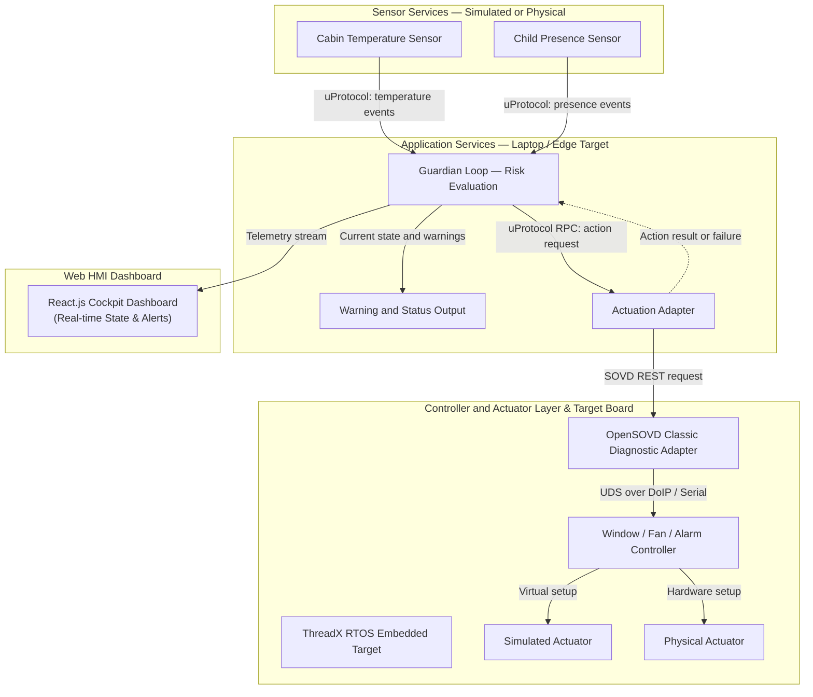

# Software-Defined Vehicle (SDV) Telemetry & Safety HMI

An industry-grade, real-time Web Human-Machine Interface (HMI) and telemetry dashboard developed as a part of the **Eclipse SDV 2026 Hackathon**. This project bridges low-level embedded hardware execution with a modern web dashboard to deliver real-time vehicle telemetry, safety-critical state alerts, and child presence detection capabilities.

---

# System Architecture & Pipeline

The system architecture is structured with clear isolation between sensor services, central application logic, controller layers, and the web-based HMI dashboard:

https://github.com/user-attachments/assets/841010f8-67a1-4103-8471-3d0cbcaba61d

