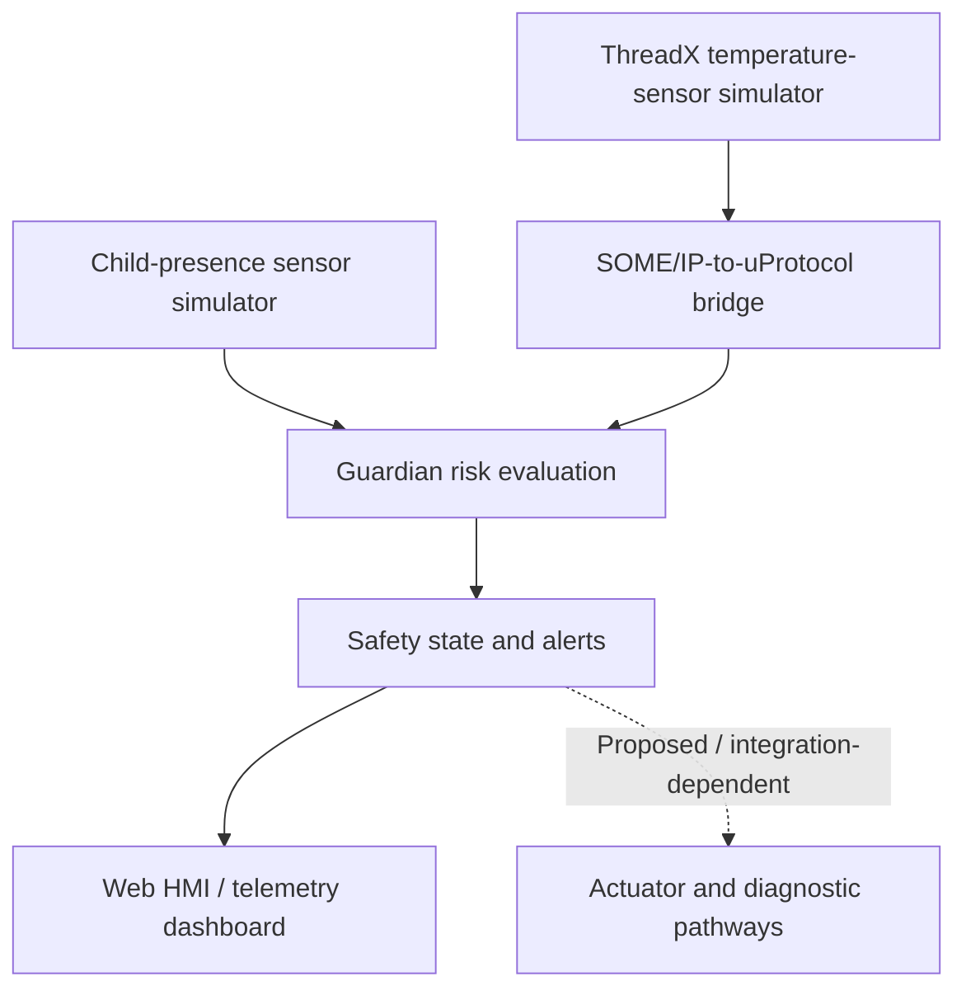

# Guardian Loop | Vehicle Safety Telemetry & Web HMI

**Eclipse SDV Hackathon 2026 · Team Six_In_Sync**

A browser-based monitoring interface for an automotive child-presence and cabin-safety prototype. This repository showcases the **telemetry visualization and human–machine interface (HMI)** portion of Guardian Loop, a team project exploring modular software-defined vehicle (SDV) services.

> **Prototype scope:** This is a hackathon demonstration, not a production automotive safety system. Sensor readings, actuator behavior, and system integration may be simulated. Do not use this project to make real-world safety decisions.

## Demo

- [Dashboard source](./web_dashboard.html)
- [Recorded dashboard demo](./Demo_2%20%281%29.mp4)
- [Original Six_In_Sync team implementation](https://github.com/Eclipse-SDV-Hackathon-Chapter-Four/Six_In_Sync)

## Real-Time Dashboard Demonstration

[▶ Watch the Demo Video](./Demo_2%20%281%29.mp4)

## What the dashboard demonstrates

- Multi-service terminal-style views for Guardian, child-presence sensing, temperature sensing, and actuator simulation.
- Safety status presentation: `CLEAR`, `MONITORING`, `WARNING`, and `CRITICAL`.
- WebSocket client for receiving and parsing JSON telemetry/events, subject to a compatible backend.
- Visual status changes and browser-generated audible alerts.
- A browser-oriented HMI intended to make distributed safety-service behavior easier to observe during demonstrations.

## System context

The broader **Six_In_Sync / Guardian Loop** prototype explores a sensor-to-decision pipeline:

The diagram combines the team's documented architecture with the HMI concept. **It does not by itself verify that every arrow is implemented end to end.** See the original team repository for service source code and build instructions.

## Technology overview

| Layer | Technology | Scope in this repository |
| --- | --- | --- |
| HMI | HTML5, CSS3, JavaScript | Dashboard source included |
| Browser event transport | WebSocket, JSON | Client-side handling; backend required for live data |
| Guardian services | Rust | Documented in linked team repository |
| Temperature sensor | ThreadX Linux-port simulator | Documented in linked team repository |
| Sensor bridge | SOME/IP, uProtocol | Documented in linked team repository |
| Diagnostics / deployment | OpenSOVD, UDS, openDuT, AutoSD | Architectural context; integration status should be verified before claiming implementation |

## Getting started

### View the interface

Open [`web_dashboard.html`](./web_dashboard.html) in a modern browser. Static interface elements may render without a backend, but **live events require the matching WebSocket service**. Browser audio and notification behavior may depend on browser permissions and user interaction.

### Run the broader prototype

Use the [Six_In_Sync team repository](https://github.com/Eclipse-SDV-Hackathon-Chapter-Four/Six_In_Sync) for the Guardian Rust services, temperature-sensor simulator, communication bridge, prerequisites, and run commands. The standalone dashboard repository does **not** bundle those backend executables.

## Suggested validation scenarios

The following are **test cases to document**, not claims of completed tests:

| Scenario | Expected HMI behavior | Result |
| --- | --- | --- |
| Normal cabin conditions | `CLEAR` state | Not recorded here |
| Child-presence event | State reflects Guardian decision | Not recorded here |
| Temperature threshold crossed | Warning/critical indication if emitted by Guardian | Not recorded here |
| Actuator event | Relevant service log appears | Not recorded here |
| WebSocket disconnected | Connection failure is observable | Not recorded here |

Add actual logs, screenshots, thresholds, and measured latencies only after verifying them against the implementation.

## Personal contribution and attribution

This repository presents the web telemetry/HMI artifact under **lindsayk09**. The overall Guardian Loop system was developed as a **team hackathon project** by **Six_In_Sync**. For full implementation details and team contributions, see the [official project repository](https://github.com/Eclipse-SDV-Hackathon-Chapter-Four/Six_In_Sync).

> **To complete before publishing:** Specify which dashboard, WebSocket, integration, testing, and backend tasks you personally implemented. Do not imply sole authorship of the entire team system.

## Roadmap

- [ ] Confirm the live WebSocket backend endpoint and event payload schema.
- [ ] Add a screenshot and a short annotated demonstration.
- [ ] Document validated safety-state transitions and test results.
- [ ] Add local setup steps for the matching backend, if publicly shareable.
- [ ] Add a concise personal contribution statement.
- [ ] Document licensing and third-party dependencies.

## Acknowledgment

Created in the context of the **Eclipse SDV Hackathon 2026** with **Team Six_In_Sync**. The original team repository is the source of truth for the shared Guardian Loop implementation.
